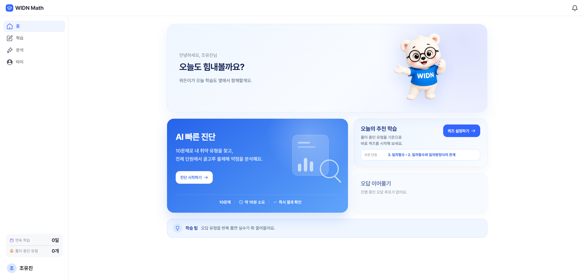
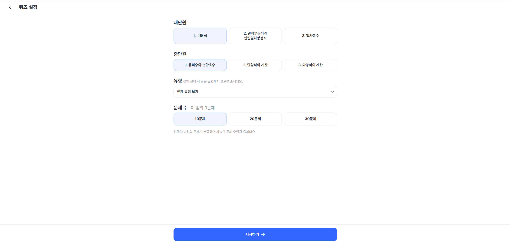
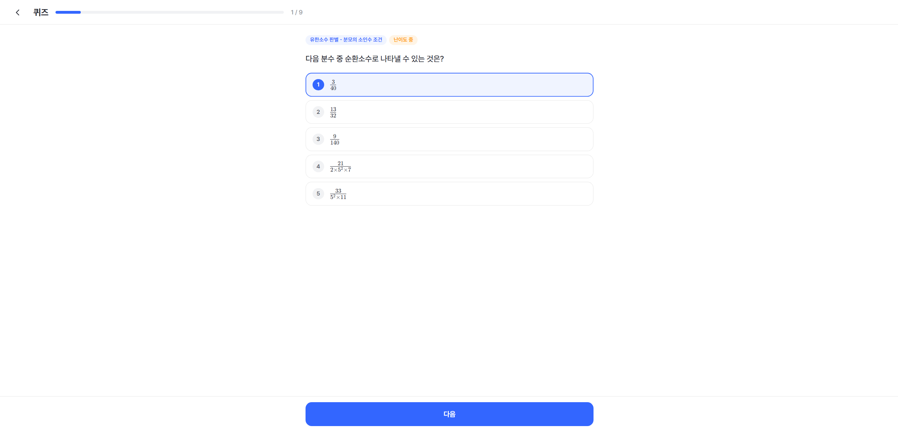
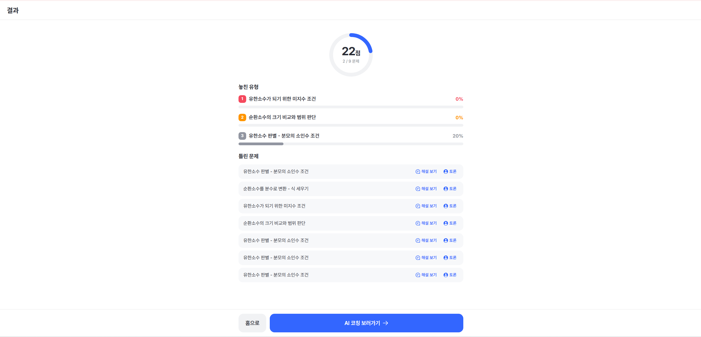
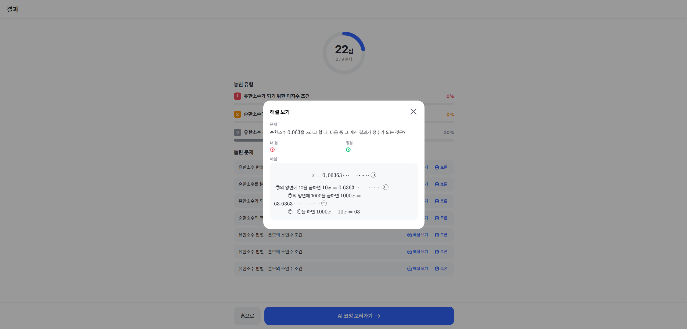
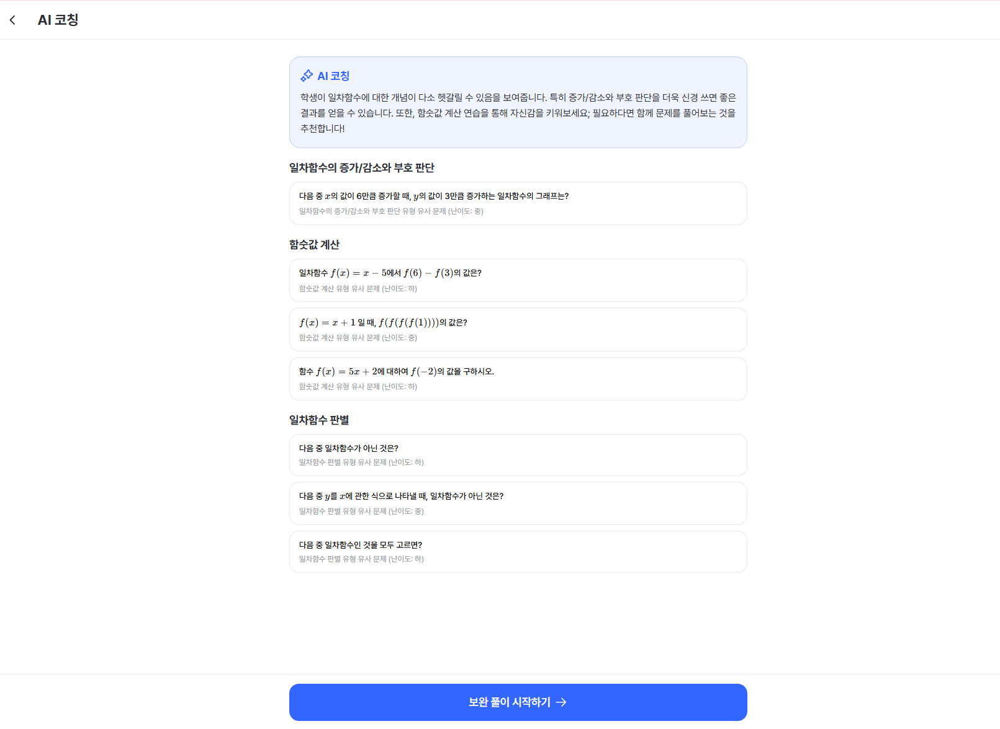
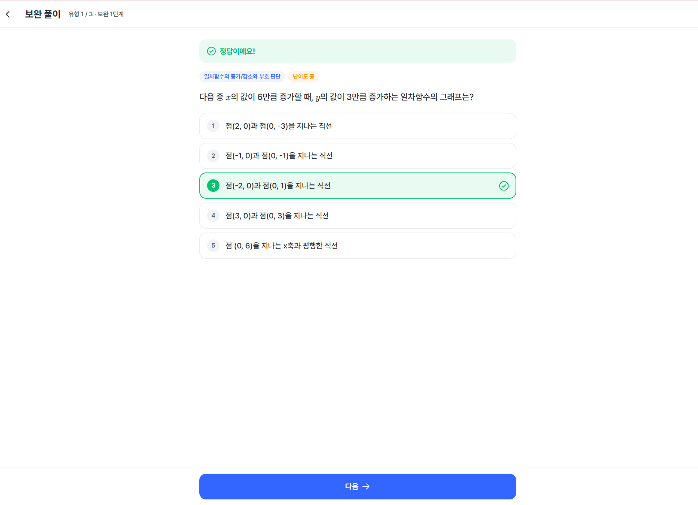
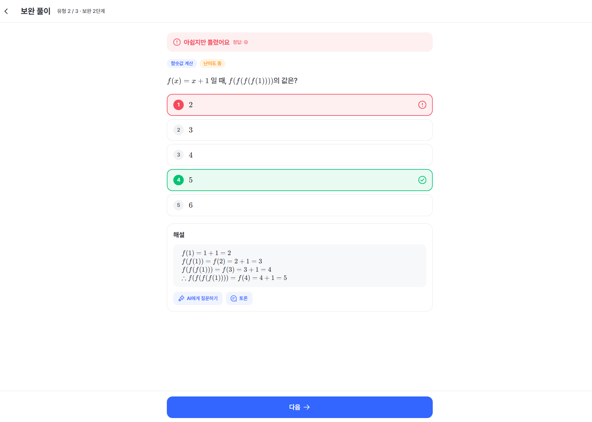
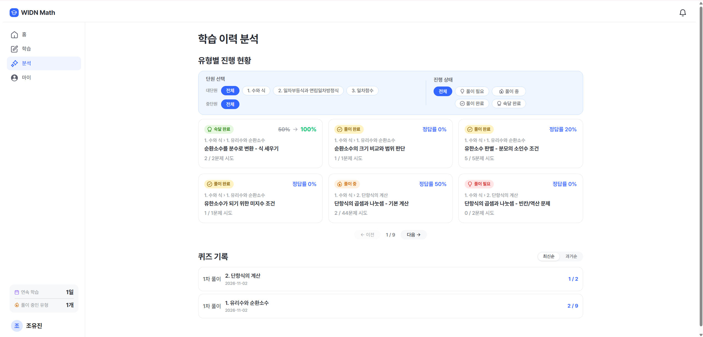
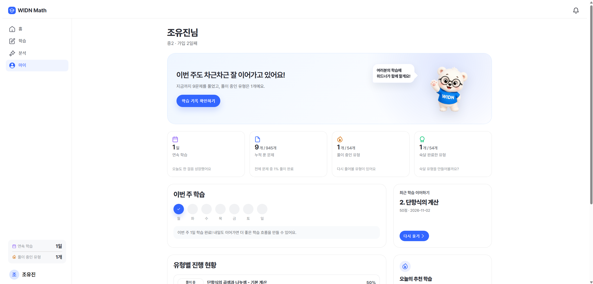

# WIDN Math

## 프로젝트 개요

틀린 문제를 다시 풀 수 있을 때까지 연결해 주는 **AI 수학 코칭 서비스**입니다.
문제를 틀린 뒤 어떤 유형을 더 연습해야 할지 스스로 찾는 부담을 줄이고자 기획했습니다.
중학교 수학 퀴즈의 오답을 유형별로 분석해 코칭과 유사 문제를 제시하고, **보완 풀이 후 원래 문제에 재도전하는 과정**까지 한 흐름으로 연결합니다.

2인 팀 프로젝트 · 2026.05.26 ~ 2026.06.26


## 서비스 시작

| 홈 | 퀴즈 설정 |
| --- | --- |
|  |  |
| 빠른 진단과 추천 학습으로 시작합니다. | 단원·유형·문제 수를 선택합니다. |

## 학습 흐름

| 퀴즈 풀이 | 결과 |
| --- | --- |
|  |  |
| 문제를 풀고 답안을 제출합니다. | 점수, 놓친 유형, 틀린 문제를 확인합니다. |

| 오답 해설 | AI 코칭 |
| --- | --- |
|  |  |
| 틀린 문제의 정답과 풀이를 확인합니다. | 취약 유형 피드백과 추천 문제를 확인합니다. |

| 보완 풀이 1단계 | 보완 풀이 2단계 |
| --- | --- |
|  |  |
| 같은 유형의 문제로 다시 연습합니다. | 정오답과 해설을 확인하며 다음 단계로 진행합니다. |

| 학습 기록 | 마이페이지 |
| --- | --- |
|  |  |
| 유형별 진행 상태와 퀴즈 이력을 살펴봅니다. | 연속 학습과 최근 학습 현황을 확인합니다. |


## 주요 기능

1. **퀴즈와 빠른 진단**: 단원·세부 유형·문제 수를 설정하거나 10문제 빠른 진단을 시작합니다. 제출 후 정오답과 해설을 확인합니다.
2. **AI 코칭과 문제 추천**: 오답을 유형별로 분석해 취약 유형을 보여주고 학습 피드백과 보완 문제를 제공합니다. 백엔드는 LangGraph, 임베딩, ChromaDB로 이 흐름을 처리합니다.
3. **보완 학습 루프**: 취약 유형마다 추천 문제를 단계별로 풀고 원래 틀린 문제에 다시 도전합니다. 풀이 결과에 따라 다음 단계를 달리하며, 중단한 학습은 홈과 학습 기록에서 이어갈 수 있습니다.
4. **학습 현황과 커뮤니티**: 마이페이지에서 학습량·연속 학습·유형별 숙달 현황을 확인하고, 문제별 게시글과 댓글로 풀이를 공유합니다.

## 담당 역할과 구현 포인트

**조유진 · 기획, UI/UX 디자인, Vue 프론트엔드 전체 구현**

- 퀴즈 설정부터 결과, AI 코칭, 보완 학습까지 이어지는 화면 흐름을 설계하고 Vue 3 화면으로 구현했습니다.
- Pinia에서 퀴즈 세션, 답안, 제출 결과, 보완 학습 진행 상태를 관리해 여러 화면에 걸친 학습 흐름을 연결했습니다.
- 보완 학습 중 화면을 떠나도 사용자별 `localStorage` 키로 진행 정보를 보관하고, 홈·학습 기록에서 이어 풀 수 있도록 구현했습니다.
- 마이페이지와 학습 기록에서 연속 학습, 최근 세션, 유형별 숙달 상태를 보여주고 필터·정렬·페이지 이동을 제공했습니다.
- 공통 레이아웃과 문제·선택지 컴포넌트를 구성하고, 문제별 커뮤니티 화면을 구현했습니다.

AI 분석, 추천 API와 문제 데이터 처리 코드는 팀 프로젝트의 백엔드 구성입니다. 위 담당 역할은 제 기여 범위를 기준으로 적었습니다.

## 기술 구성

| 영역 | 기술 및 구성 |
| --- | --- |
| 프론트엔드 | Vue 3, Vite, Pinia, Vue Router, Axios |
| 백엔드 | Django 4.2, Django REST Framework, SQLite |
| AI·추천 | LangGraph, OpenAI 호환 API, ChromaDB |
| 데이터 | 수학 문제 JSON·CSV 전처리, Django 관리 명령을 통한 DB 적재 |

```text
front/               Vue 화면, 컴포넌트, 라우터, Pinia 스토어
app/                 Django API, 모델, AI 코칭 그래프, 데이터 적재 명령
src/preprocessing/   문제 데이터 전처리
scripts/             데이터 정리 및 벡터 DB 구축 스크립트
data/                문제 데이터와 전처리 결과
screenshots/         README에 표시할 서비스 화면 캡처
```

## 로컬 실행

Python과 Node.js가 필요합니다. 루트의 `.env.example`에 적힌 `SECRET_KEY`, `GMS_KEY`를 실행 환경에 설정한 뒤 백엔드와 프론트엔드를 각각 실행합니다.

```bash
python -m pip install -r requirements.txt
python app/manage.py migrate
python app/manage.py runserver
```

별도 터미널에서 프론트엔드를 실행합니다.

```bash
cd front
npm ci
npm run dev
```

프론트엔드는 `http://localhost:5173`, API는 `http://localhost:8000/api/v1`을 사용하도록 구성되어 있습니다. **퀴즈와 AI 코칭을 실제로 이용하려면** 문제 데이터의 DB 적재, ChromaDB 구축, 사용 가능한 AI API 키가 추가로 필요합니다. 위 명령만으로 전체 학습 데이터가 자동 준비되지는 않습니다.
